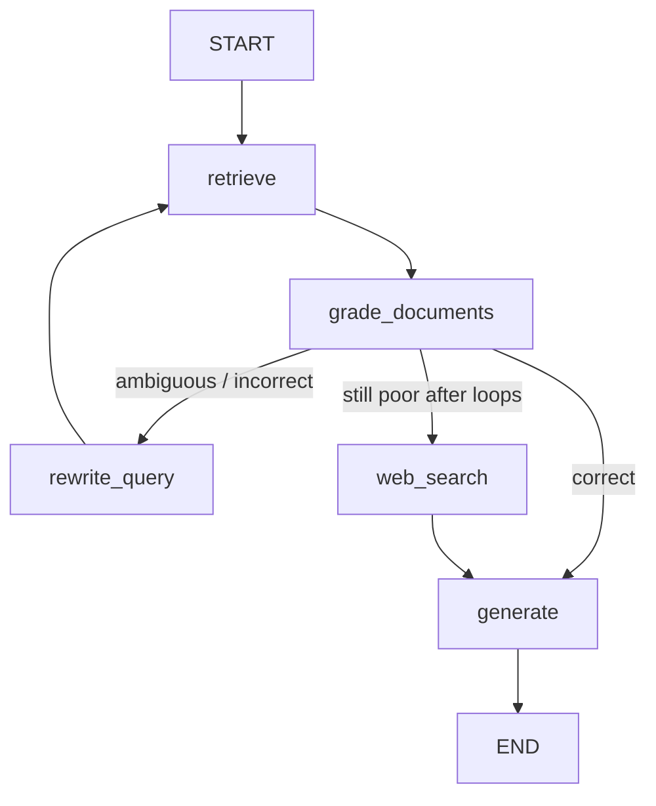

# Corrective RAG (CRAG) Agent

LangGraph agentic loop that **grades retrieved documents** before generation. Poor retrieval triggers **query reformulation** and optional **web search** (DuckDuckGo), following the Corrective RAG pattern.

## Flow



## Setup

```powershell
cd $env:USERPROFILE\Projects\crag-agent
python -m venv .venv
.\.venv\Scripts\Activate.ps1
pip install -r requirements.txt
copy .env.example .env
# Edit .env and set OPENAI_API_KEY
```

If `pip` fails with SSL certificate errors on Windows, use:

```powershell
pip install --trusted-host pypi.org --trusted-host pypi.python.org --trusted-host files.pythonhosted.org -r requirements.txt
```

## Run

```powershell
python main.py "What is Corrective RAG and when does it use web search?"
python main.py "Who won the 2026 World Series?"  # likely triggers web fallback
```

## Project layout

| Path | Role |
|------|------|
| `src/graph.py` | LangGraph CRAG workflow |
| `src/graders.py` | Per-document and batch relevance grading |
| `src/retrieval.py` | Chroma + OpenAI embeddings over `data/knowledge_base.txt` |
| `src/web_search.py` | DuckDuckGo fallback |
| `src/state.py` | Graph state types |

## Configuration

- `OPENAI_API_KEY` — required for embeddings, grading, rewrite, and answer
- `OPENAI_MODEL` — optional (default `gpt-4o-mini`)
- `--max-loops` — reformulation attempts before web search (default `2`)

## Self-RAG vs this build

This repo implements **Corrective RAG** (evaluate retrieval → correct → generate). **Self-RAG** adds generation-time critique (support / utility tokens). Extend `src/graph.py` with a `reflect` node and structured self-critique if you need full Self-RAG.
